# Robot JetMax đánh cờ tướng: từ dữ liệu đến thư viện "ảnh bàn cờ → nước đi"

Thư mục này chứa toàn bộ quy trình xây dựng thư viện **XiangqiBrain**: nhận ảnh bàn cờ tướng (kèm thế cờ lượt trước), trả về nước đi tiếp theo dưới dạng **ô gắp → ô đặt** cho cánh tay robot. Tài liệu tập trung vào hai vấn đề chính của đề tài:

1. **Robot JetMax**: phần cứng, thông số, giới hạn, và các ràng buộc mà nó đặt lên phần mềm.
2. **Học sâu**: dữ liệu, mô hình YOLO11n, cách huấn luyện, kết quả, và cách đưa mô hình lên robot.

Phần xử lý ảnh và luật cờ chỉ được tóm tắt; chi tiết nằm trong các notebook tương ứng.

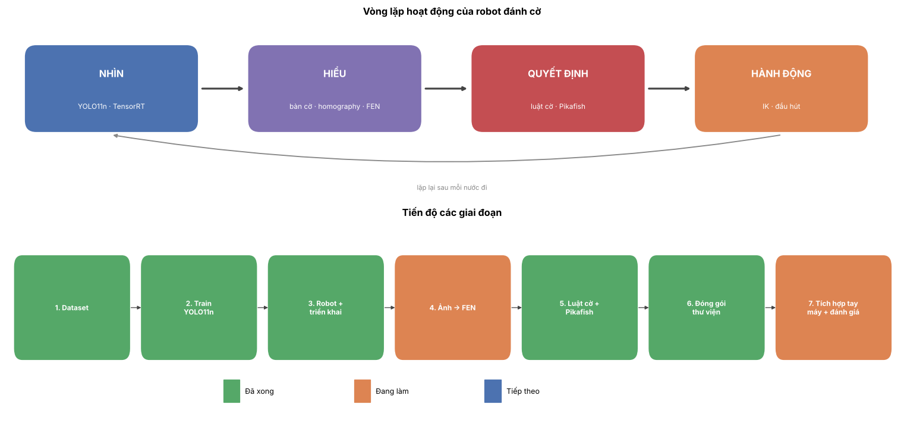

## Mục lục

- [1. Tổng quan và thứ tự các notebook](#1-tổng-quan-và-thứ-tự-các-notebook)
- [2. Robot JetMax](#2-robot-jetmax)
- [3. Học sâu: nhận diện 14 loại quân cờ bằng YOLO11n](#3-học-sâu-nhận-diện-14-loại-quân-cờ-bằng-yolo11n)
- [4. Từ nhận diện đến nước đi](#4-từ-nhận-diện-đến-nước-đi)
- [5. Xử lý ảnh (tóm tắt)](#5-xử-lý-ảnh-tóm-tắt)
- [6. Mang sang robot](#6-mang-sang-robot)
- [7. Hạn chế và việc còn lại](#7-hạn-chế-và-việc-còn-lại)
- [8. Hình trong báo cáo lấy từ đâu](#8-hình-trong-báo-cáo-lấy-từ-đâu)

---

## 1. Tổng quan và thứ tự các notebook

Mọi notebook chạy trên **Google Colab**; dữ liệu và kết quả lưu ở Drive `MyDrive/datn/`. Bấm nút *Open in Colab* ở đầu mỗi notebook.

```
Bước 1 build_dataset ──► Bước 2 train_yolo11 ──► Bước 3 jetmax_deploy
                                   │
                                   ├──► Bước 4 board_to_fen ──► Bước 5 rules_engine ──► Bước 6 package
                                   │
image_preprocessing (minh hoạ xử lý ảnh, chạy độc lập)
```

| Notebook | Trọng tâm | Việc chính | Đầu ra | GPU |
|---|---|---|---|---|
| `build_dataset.ipynb` (Bước 1) | Học sâu | Gộp 4 bộ Roboflow, chuẩn hoá 14 lớp, chia tập theo nhóm chống rò rỉ | `merged_v1.zip` | Không |
| `train_yolo11.ipynb` (Bước 2) | **Học sâu** | Chọn mô hình, kiến trúc YOLO11n, huấn luyện 2 giai đoạn, đánh giá, xuất ONNX | `best.pt`, `best.onnx` | T4 |
| `jetmax_deploy.ipynb` (Bước 3) | **Robot** | Thông số JetMax + Jetson Nano, tầm với, `pt → onnx → engine`, các lệnh triển khai | Hướng dẫn, kiểm tra ONNX | Không |
| `board_to_fen.ipynb` (Bước 4) | Học sâu → robot | Đo cả chuỗi ảnh → thế cờ (FEN) trên tập test, chọn ngưỡng tin cậy | Bảng số liệu | Không |
| `rules_engine.ipynb` (Bước 5) | Robot | Luật cờ, tự sửa lỗi nhận diện, engine Pikafish | `pikafish_jetson.tar.gz` | Không |
| `package.ipynb` (Bước 6) | Robot | Kiểm thử `XiangqiBrain`, đóng gói một file cho robot + gói demo Windows | `xiangqi_to_robot.zip` | Không |
| `image_preprocessing.ipynb` | Phụ trợ | Minh hoạ các bước xử lý ảnh trên 3 ảnh thật | Hình minh hoạ | Không |

---

## 2. Robot JetMax

**JetMax** là cánh tay robot giáo dục của hãng **Hiwonder**, dùng máy tính nhúng **NVIDIA Jetson Nano** làm bộ điều khiển. Camera gắn trên cánh tay; Jetson Nano vừa chạy mô hình học sâu vừa điều khiển khớp tay, không cần máy tính ngoài.

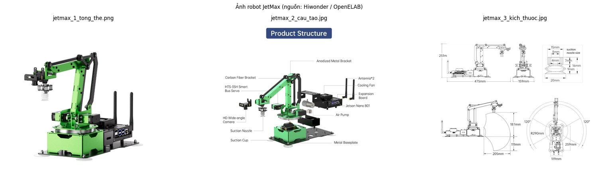

*Nguồn ảnh: Hiwonder, qua trang sản phẩm của đại lý OpenELAB (https://openelab.io/products/hiwonder-jetmax-jetson-nano-robot).*

### 2.1 Thông số cánh tay

| Thông số | Giá trị | Ý nghĩa với đề tài |
|---|---|---|
| Số bậc tự do | **4 + 1** (đế xoay, vai, khuỷu + khớp cổ tay xoay đầu hút) | Đủ để gắp–đặt vật trên mặt phẳng; khớp +1 xoay được quân |
| Tầm với | **104 – 289 mm** tính từ trục đế | Giới hạn vùng đặt bàn cờ (mục 2.4) |
| Góc quét của đế | **240°** | Bàn cờ và vùng chứa quân phải nằm trong cung này |
| Độ lặp lại | **±1 mm** | Nhỏ so với quân Ø25 mm |
| Tải trọng | tối đa **450 g** | Quân cờ chỉ vài gram |
| Tốc độ khớp | 0.20 s / 60° | Một lần gắp–đặt mất vài giây |
| Servo | Servo bus thông minh HTS-35H + servo chống kẹt LFD-01M | Đọc được vị trí từng khớp |
| Cơ cấu chấp hành | Đầu **hút chân không**, kẹp nhỏ, kẹp lớn, bút | Chọn **đầu hút**: mặt quân phẳng, tròn, dày 10 mm |
| Khối lượng / kích thước | ~1.6 kg · 475 × 159 × 251 mm | |
| Nguồn | 12 V / 5 A | Nguồn yếu làm servo giật, Jetson tự khởi động lại |
| Kết nối | USB, Wi-Fi, Ethernet | Điều khiển từ xa qua NoMachine / SSH |

### 2.2 Bộ điều khiển Jetson Nano và phần mềm trên robot

| Thành phần | Thông số | Ghi chú |
|---|---|---|
| CPU | 4 nhân ARM Cortex-A57 @ 1.43 GHz | Kiến trúc ARM (aarch64), không phải x86 như laptop |
| GPU | **128 nhân CUDA, kiến trúc Maxwell** | ~472 GFLOPS FP16, yếu hơn GPU T4 trên Colab hàng chục lần |
| RAM | **4 GB dùng chung CPU + GPU** | Rất ít RAM trống khi ROS chạy |
| Camera | `/dev/usb_cam0`, **640 × 480**, YUYV | Ảnh đầu vào cho mô hình |
| JetPack / L4T | **4.6.1** / R32.6.1 (Ubuntu 18.04) | Bản JetPack cuối hỗ trợ Jetson Nano |
| CUDA · TensorRT | 10.2 · **8.0.1.6** | Quyết định định dạng mô hình (mục 3.9) |
| Python | **3.6.9** | Ultralytics cần Python ≥ 3.8 → không cài được trên robot |
| ROS | ROS 1 Melodic | Hệ thống điều khiển của Hiwonder |
| Mạng | **Không vào được Internet** | File được chép từ laptop qua NoMachine |

> JetPack, CUDA, TensorRT, Python, RAM và camera do nhóm **đo trực tiếp trên robot**. Thông số cánh tay lấy từ trang sản phẩm của Hiwonder.

### 2.3 Sơ đồ khối

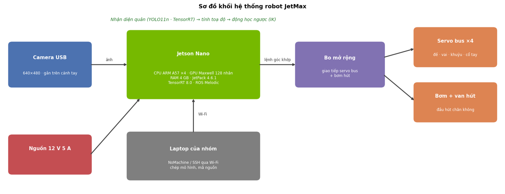

### 2.4 Không gian làm việc so với bàn cờ

Đây là ràng buộc cơ khí quan trọng nhất. Tầm với là hình vành khăn **104–289 mm** trong cung **240°**; bàn cờ nhựa của bộ cờ là **360 × 260 mm**. Cạnh dài bàn cờ lớn hơn bán kính tầm với, nên robot **không thể với tới toàn bộ bàn cờ** khi đặt cố định một chỗ.

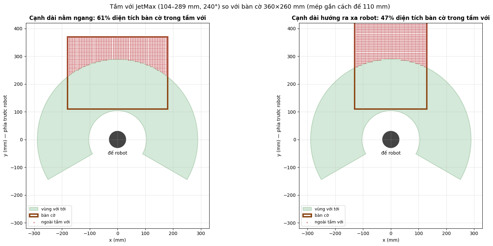

| Cách đặt bàn cờ | Phần diện tích bàn trong tầm với (tốt nhất) |
|---|---|
| Cạnh dài nằm ngang | **70%** |
| Cạnh dài hướng ra xa robot | 53% |

Hệ quả: robot chỉ đi quân trong phần bàn cờ với tới được (nửa bàn phía robot). Các hướng mở rộng: bàn cờ nhỏ hơn, hoặc phụ kiện ray trượt của Hiwonder.

### 2.5 Đọc thông số: robot làm được gì với quân cờ?

| Câu hỏi | Tính toán | Kết luận |
|---|---|---|
| Độ lặp ±1 mm có đủ không? | Bước lưới ngang 220 / 8 = **27.5 mm**, quân Ø25 mm → khe hở giữa hai quân kề nhau **2.5 mm** | Đủ về cơ khí, nhưng sai số định vị bằng camera + hiệu chuẩn phải giữ dưới ~1 mm |
| Vùng với tới rộng bao nhiêu? | π (289² − 104²) × 240/360 ≈ **1 523 cm²** | Lớn hơn bàn cờ (936 cm²) nhưng hình dạng không khớp → chỉ phủ ~70% bàn |
| Đầu hút có vừa quân không? | Miệng hút khoảng 20 mm (bản vẽ của hãng), mặt quân Ø25 mm | Tâm lệch dưới ~2.5 mm thì miệng hút vẫn nằm gọn trong mặt quân |
| Một lần gắp–đặt mất bao lâu? | 0.20 s / 60° → quét hết 240° ≈ 0.8 s | Thời gian mỗi nước chủ yếu do chụp ảnh + suy luận + engine |

### 2.6 Ràng buộc của robot quyết định thiết kế phần mềm

| Ràng buộc | Số liệu | Quyết định trong đề tài |
|---|---|---|
| GPU nhỏ | ~472 GFLOPS FP16 | Chọn bản **nano**: YOLO11n 6.5 GFLOPs mỗi ảnh |
| RAM dùng chung | 4 GB | Engine **FP16**; Pikafish giới hạn `Hash` 16–64 MB |
| TensorRT cũ | 8.0.1.6 | Xuất ONNX **opset 12** |
| Python cũ | 3.6.9 | Không có Ultralytics → **tự viết** letterbox, giải mã đầu ra, NMS (`vision/pieces.py`) |
| Không Internet | — | Mang sang robot **một file** `xiangqi_to_robot.zip` |
| Camera | 640 × 480 | Khớp với `imgsz = 640`: tỉ lệ 1.0, chỉ đệm 80 px trên/dưới |
| Tầm với | 104–289 mm | Robot chỉ đi quân ở nửa bàn phía mình |

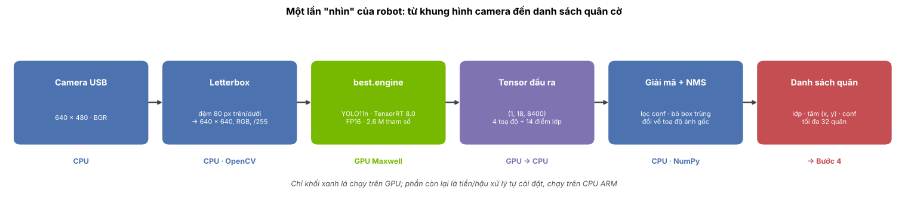

Chi tiết: `jetmax_deploy.ipynb`.

---

## 3. Học sâu: nhận diện 14 loại quân cờ bằng YOLO11n

### 3.1 Bài toán

Từ một ảnh, mô hình phải trả về **vị trí (bounding box)** và **loại quân** của tối đa 32 quân. Có **14 lớp** = 7 loại quân × 2 màu. Các quân cùng là đĩa tròn giống nhau, chỉ khác **chữ Hán và màu mực**.

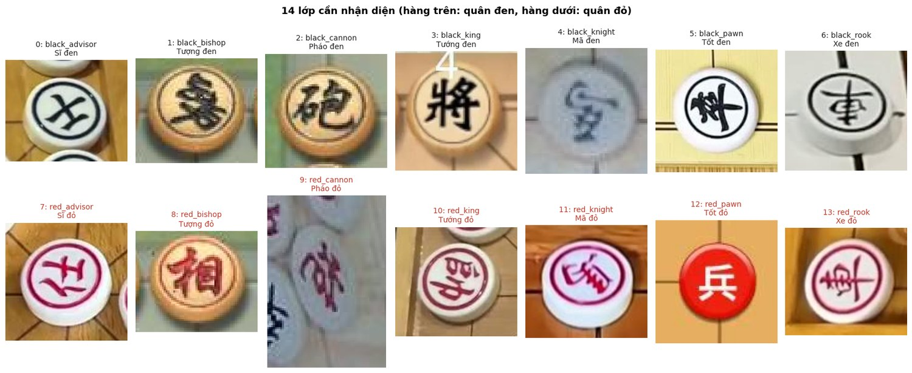

| id | lớp | FEN | id | lớp | FEN |
|---|---|---|---|---|---|
| 0 | black_advisor (Sĩ) | a | 7 | red_advisor | A |
| 1 | black_bishop (Tượng) | b | 8 | red_bishop | B |
| 2 | black_cannon (Pháo) | c | 9 | red_cannon | C |
| 3 | black_king (Tướng) | k | 10 | red_king | K |
| 4 | black_knight (Mã) | n | 11 | red_knight | N |
| 5 | black_pawn (Tốt) | p | 12 | red_pawn | P |
| 6 | black_rook (Xe) | r | 13 | red_rook | R |

### 3.2 Dữ liệu (`merged_v1`, Bước 1)

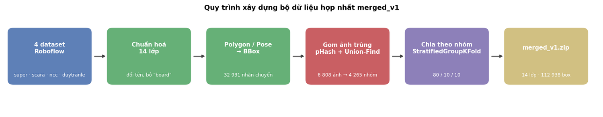

Sau làm sạch: **6 808 ảnh, 112 938 quân, 4 265 nhóm ảnh trùng**.

| Nguồn (Roboflow Universe) | train | val | test | tổng |
|---|---|---|---|---|
| super (312s-workspace/xiangqi-super-dataset) | 1837 | 240 | 241 | 2318 |
| scara (312s-workspace/xiangqi-scara-yolo26) | 1335 | 216 | 183 | 1734 |
| new_chinese_chess (quoc-rnmzr, v1) | 1000 | 128 | 125 | 1253 |
| duytranle (duytranle/xiangqi-ubjij, v18) | 1184 | 155 | 164 | 1503 |
| **Tổng** | **5356** | **739** | **713** | **6808** |

| Việc làm | Vì sao quan trọng với mô hình |
|---|---|
| Gộp 4 nguồn khác bộ quân, ánh sáng, góc chụp | Mô hình tổng quát hoá, không học thuộc một kiểu quân |
| Chuẩn hoá tên lớp về 14 lớp; polygon / pose → bbox | Nhãn đúng dạng mà head *Detect* học |
| Gom ảnh trùng bằng pHash + union-find, **chia theo nhóm** (StratifiedGroupKFold) | Roboflow nhân 2–3 bản augment từ một ảnh gốc; nếu giữ cách chia gốc thì **1 044 ảnh bị rò rỉ** giữa các tập |

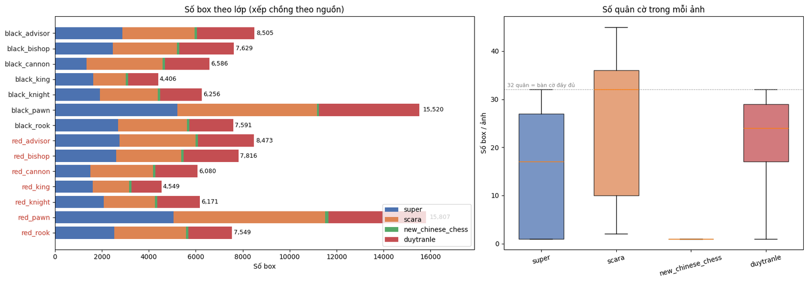

Mất cân bằng lớp là tự nhiên (5 Tốt, 1 Tướng mỗi bên: `red_pawn` gấp 3.6 lần `black_king`), lớp ít nhất vẫn trên 4 000 box nên không cần cân bằng lại.

### 3.3 Chọn mô hình: vì sao YOLO11n?

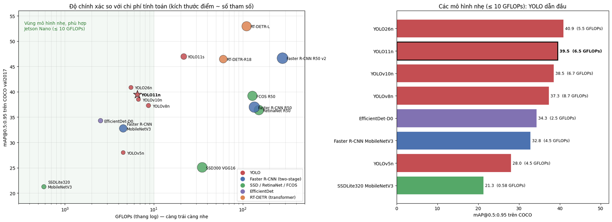

| Mô hình | mAP@0.5:0.95 (COCO) | Tham số (M) | GFLOPs | Nhận xét |
|---|---|---|---|---|
| Faster R-CNN R50-FPN | 37.0 | 41.8 | 134.4 | Chính xác tương đương nhưng nặng gấp ~20 lần |
| EfficientDet-D0 | 34.3 | 3.9 | 2.5 | Nhẹ nhưng kém 5 điểm mAP |
| RT-DETR-R18 | 46.5 | 20 | 60 | Chính xác nhất, quá nặng cho Jetson Nano |
| YOLOv8n | 37.3 | 3.2 | 8.7 | Đời trước |
| **YOLO11n** | **39.5** | **2.6** | **6.5** | **Được chọn** |
| YOLO11s | 47.0 | 9.4 | 21.6 | Phương án dự phòng (chi phí ×3.3) |

YOLO11n nằm ở vùng tối ưu chính xác / chi phí trong nhóm dưới 10 GFLOPs, có trọng số pretrained COCO, và xuất được ONNX opset 12 cho TensorRT 8 của robot.

### 3.4 Kiến trúc YOLO11n

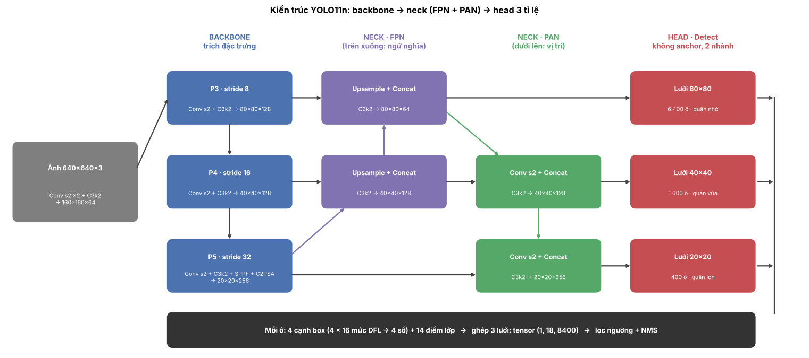

| Khối | Việc | Thành phần chính |
|---|---|---|
| **Backbone** | Trích đặc trưng, thu nhỏ ảnh dần (stride 2 → 32) | `Conv` (3×3 + BatchNorm + SiLU), `C3k2`, `SPPF`, `C2PSA` (tự chú ý ở tầng sâu nhất) |
| **Neck** | Trộn đặc trưng giữa các tỉ lệ | FPN (trên xuống: ngữ nghĩa) + PAN (dưới lên: vị trí) |
| **Head** | Dự đoán box + lớp ở 3 lưới 80×80, 40×40, 20×20 | Không anchor, hai nhánh tách rời; box qua DFL (4 cạnh × 16 mức), lớp qua sigmoid (14 điểm) |

- **8 400 dự đoán** mỗi ảnh = 80² + 40² + 20². Đầu ra ONNX là tensor `(1, 18, 8400)`: 4 toạ độ + 14 điểm lớp cho mỗi ô.
- **NMS không nằm trong mạng**; trên robot được tự cài đặt.
- Tổng thể: **101 lớp, 2.6 triệu tham số, 6.5 GFLOPs, file 5.5 MB**.

### 3.5 Huấn luyện: transfer learning 2 giai đoạn

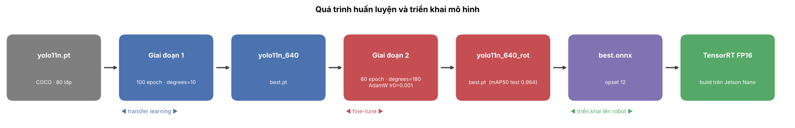

| Giai đoạn | Xuất phát | Thay đổi chính | Lý do |
|---|---|---|---|
| 0 | — | COCO, 80 lớp (Ultralytics train sẵn) | Đã biết nhận cạnh, góc, hình khối |
| 1: `yolo11n_640` | `yolo11n.pt` | 100 epoch, `degrees=10`, `fliplr=0` | Bài toán ban đầu: quân trên băng chuyền, lệch góc nhẹ |
| 2: `yolo11n_640_rot` | `yolo11n_640/best.pt` | 60 epoch, **`degrees=180`**, AdamW `lr0=0.001` | Quân nằm xoay bất kỳ 0–360° |

**Siêu tham số giai đoạn 2:**

| Tham số | Giá trị | Lý do |
|---|---|---|
| `imgsz` | 640 | Quân có cạnh trung vị ≈ 48 px sau khi thu về 640; chỉ 1.6% quân nhỏ hơn 24 px |
| `epochs` · `batch` | 60 · 32 | Fine-tune từ mô hình đã tốt; vừa bộ nhớ T4 (~6.3 GB) |
| `optimizer` · `lr0` | AdamW · 0.001 | Learning rate nhỏ để không phá đặc trưng đã học ở giai đoạn 1 |
| `degrees` | **180** | Xoay ngẫu nhiên ±180° |
| `fliplr`, `flipud` | **0** | Lật biến chữ Hán thành ảnh gương, chữ không có thật |
| `mosaic` · `close_mosaic` | 1.0 · 10 | Ghép 4 ảnh; tắt ở 10 epoch cuối |
| `hsv_h/s/v` | 0.015 / 0.7 / 0.4 | Chịu được ánh sáng khác nhau |
| `patience` | 20 | Dừng sớm nếu không cải thiện |

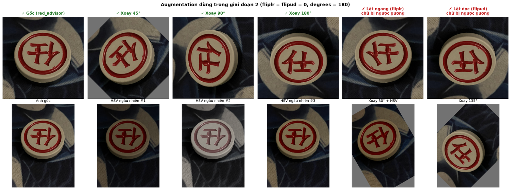

**Hàm mất mát:** L = 7.5 · L_box + 0.5 · L_cls + 1.5 · L_dfl

| Thành phần | Đo cái gì | Cách tính |
|---|---|---|
| `box_loss` | Box dự đoán lệch box thật bao nhiêu | 1 − CIoU |
| `cls_loss` | Phân lớp sai bao nhiêu | Binary cross-entropy trên 14 lớp |
| `dfl_loss` | Độ sắc của biên box | Distribution Focal Loss |

`best.pt` là epoch có fitness = 0.1 · mAP@0.5 + 0.9 · mAP@0.5:0.95 cao nhất trên tập val.

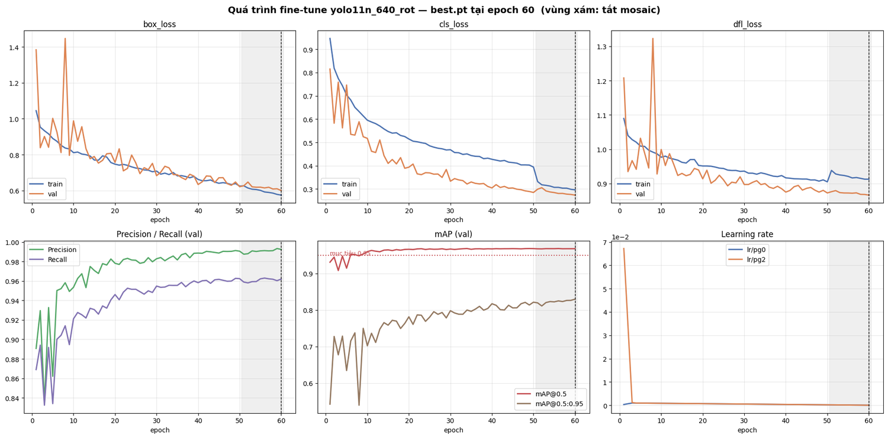

Giai đoạn 2 chạy đủ 60 epoch trong **1.7 giờ** trên Tesla T4. Loss train và val cùng giảm, không có dấu hiệu overfit.

### 3.6 Kết quả trên tập test

Mô hình `yolo11n_640_rot`, **713 ảnh test, 11 950 quân**:

| mAP@0.5 | mAP@0.5:0.95 | Precision | Recall | Mục tiêu đề cương |
|---|---|---|---|---|
| **0.964** | 0.815 | 0.990 | 0.959 | mAP@0.5 ≥ 0.95 ✅ |

Precision cao hơn Recall: mô hình **rất ít báo nhầm**, lỗi chủ yếu là **bỏ sót**. Với robot, bỏ sót an toàn hơn báo nhầm vì luật cờ bù lại được (mục 4).

| Lớp | P | R | mAP@0.5 | Lớp | P | R | mAP@0.5 |
|---|---|---|---|---|---|---|---|
| black_advisor | 1.000 | 0.967 | 0.965 | red_advisor | 0.997 | 0.940 | 0.944 |
| black_bishop | 0.985 | 0.965 | 0.962 | red_bishop | 0.996 | 0.950 | 0.964 |
| black_cannon | 0.987 | 0.937 | **0.934** | red_cannon | 0.988 | 0.951 | 0.964 |
| black_king | 0.997 | 0.989 | **0.995** | red_king | 0.991 | 0.953 | 0.955 |
| black_knight | 0.983 | 0.970 | 0.980 | red_knight | 0.985 | 0.978 | 0.980 |
| black_pawn | 0.994 | 0.971 | 0.974 | red_pawn | 0.994 | 0.964 | 0.975 |
| black_rook | 0.985 | 0.942 | 0.952 | red_rook | 0.983 | 0.949 | 0.954 |

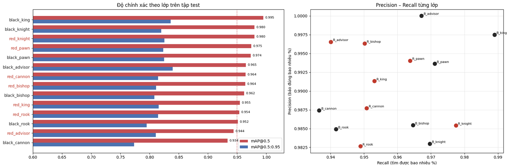

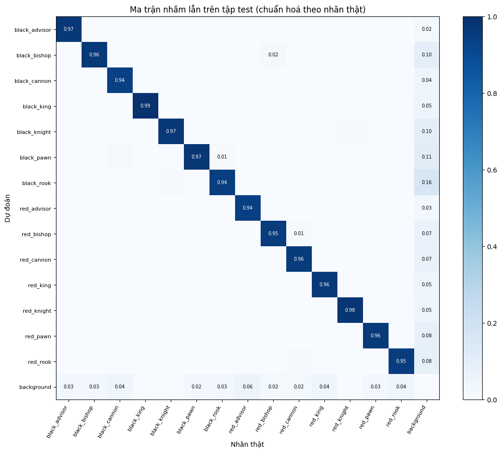

Hai lớp dưới 0.95 là `black_cannon` (0.934) và `red_advisor` (0.944). Cả hai có Precision ≥ 0.987: chúng bị bỏ sót (hàng `background`), không bị nhận thành quân khác.

### 3.7 Độ bền khi quân bị xoay

| mAP@0.5 khi xoay ảnh test | 0° | 90° | 180° | 270° |
|---|---|---|---|---|
| Giai đoạn 1 (`degrees=10`) | 0.955 | 0.762 | 0.904 | 0.761 |
| Giai đoạn 2 (`degrees=180`) | **0.964** | **0.965** | **0.963** | **0.965** |

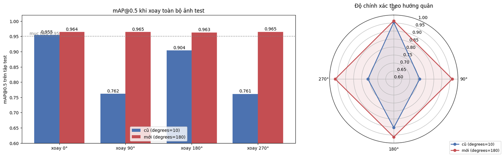

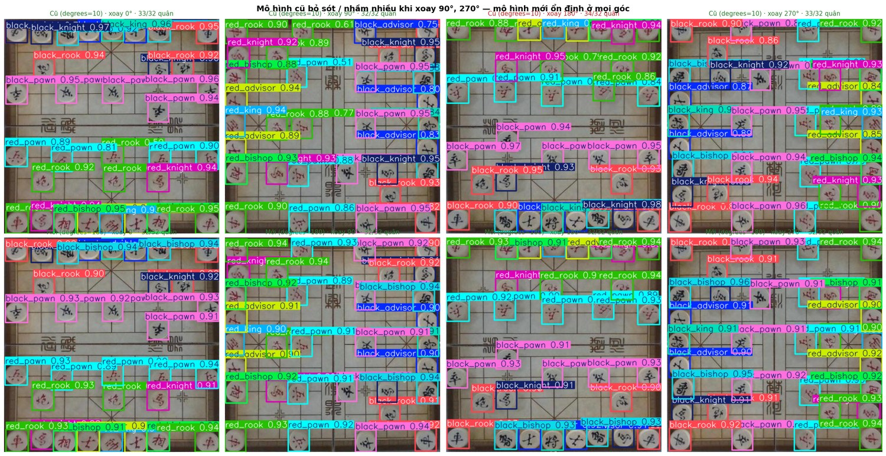

Mô hình giai đoạn 1 tụt mạnh ở 90° và 270°. Mô hình giai đoạn 2 giữ nguyên độ chính xác ở mọi góc và không giảm ở 0°.

### 3.8 Hai mạng nơ-ron trong hệ thống

| | YOLO11n | NNUE của Pikafish |
|---|---|---|
| Việc | **Nhìn**: ảnh → vị trí và loại quân | **Đánh giá** thế cờ bên trong engine |
| Ai huấn luyện | Đề tài (fine-tune 2 giai đoạn) | Nhóm Pikafish; đề tài dùng lại `pikafish.nnue` (~48 MB) |
| Chạy trên robot | GPU, TensorRT FP16 | CPU ARM |

### 3.9 Đưa mô hình lên robot: `best.pt` → `best.onnx` → `best.engine`

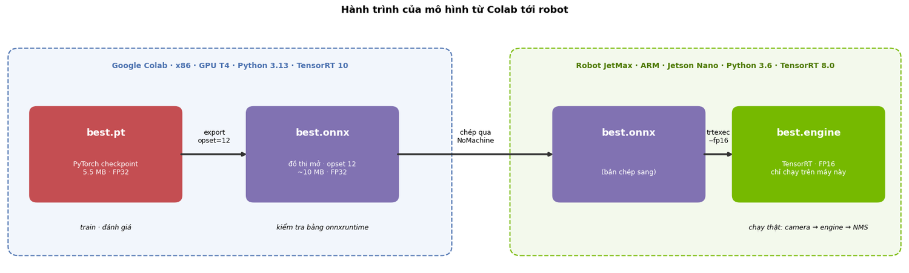

| | `best.pt` | `best.onnx` | `best.engine` |
|---|---|---|---|
| Là gì | Checkpoint PyTorch | Đồ thị tính toán định dạng mở | Mô hình đã được TensorRT biên dịch cho một GPU |
| Tạo ở đâu | Colab, sau khi train | Colab (`export`, opset 12) | **Trên chính Jetson Nano** (`trtexec --fp16`) |
| Chạy trên robot? | Không (Python 3.6) | Được nhưng chậm | **Nhanh nhất**, GPU + FP16 |
| Mang sang máy khác? | Có | Có | Không |

Tạo `best.engine` là **build** (biên dịch, gộp lớp, chọn kernel, hạ FP32 → FP16), không phải train; trọng số giữ nguyên. ONNX khớp PyTorch: sai lệch lớn nhất **1.07e-3**, lớp dự đoán trùng **100%**.

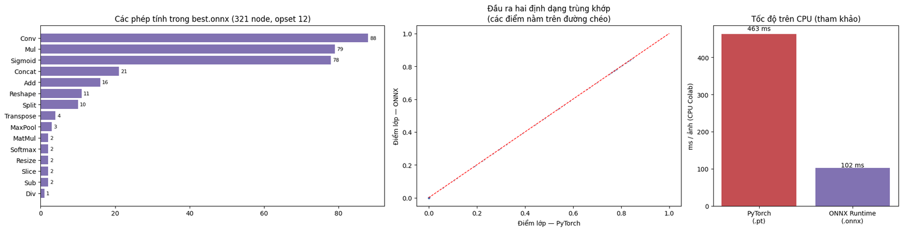

Chi tiết: `train_yolo11.ipynb` (mục 1–8), `jetmax_deploy.ipynb` (mục 5–6).

---

## 4. Từ nhận diện đến nước đi

Mô hình được chấm theo **từng quân**, robot cần **cả thế cờ đúng**. Với 23 quân trên bàn, mỗi quân sai 4% là xác suất cả bàn đúng tụt rất nhanh.

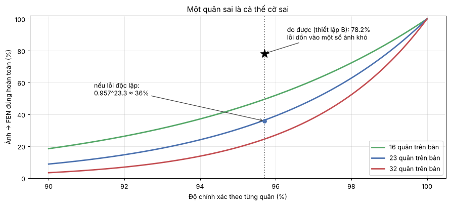

| Chỉ số (229 ảnh test có bàn cờ, ngưỡng 0.5) | Kết quả |
|---|---|
| Độ chính xác theo quân (đúng ô, đúng loại) | 95.7% |
| Ảnh → FEN đúng hoàn toàn (end-to-end) | 78.2% |
| Biết thế lượt trước → suy ra đúng nước đi | **95.2%** (ngưỡng 0.25: 96.9%) |
| Không chắc → yêu cầu chụp lại | 4.8% |
| Sai mà không phát hiện | **0%** |
| Bộ sinh nước đi (perft 1–4 từ khai cuộc) | 44 / 1 920 / 79 666 / 3 290 240, khớp giá trị chuẩn |

Luật cờ và thế cờ lượt trước biến bộ nhận diện "đúng 78%" thành hệ thống "đúng 95%, phần còn lại biết mình không chắc". Robot chỉ ra tay khi thế cờ đã được xác nhận. Nước đi tiếp theo do engine **Pikafish** chọn qua giao thức UCI.

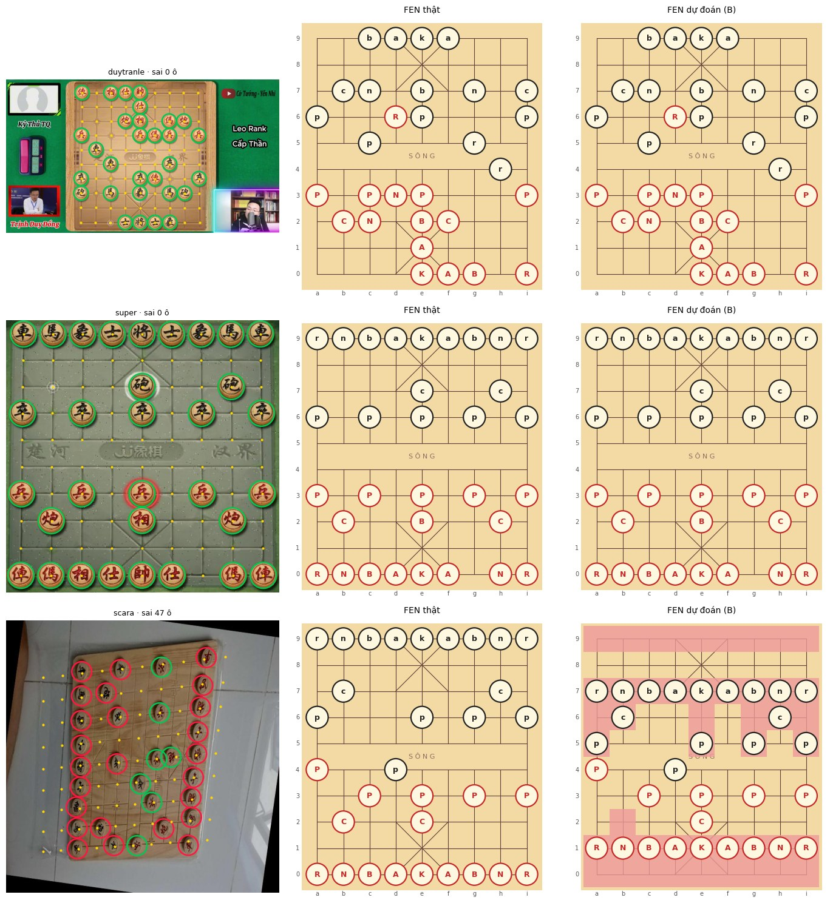

Chi tiết: `board_to_fen.ipynb`, `rules_engine.ipynb`.

---

## 5. Xử lý ảnh (tóm tắt)

Xử lý ảnh là phần phụ trợ: chuẩn bị ảnh cho mô hình và cho robot biết quân nằm ở ô nào.

| Nhánh | Phục vụ | Làm gì | Kết quả trên ảnh mẫu |
|---|---|---|---|
| Chuẩn bị ảnh cho YOLO11n | Mô hình | Letterbox 640, BGR → RGB, chia 255 | Tỉ lệ 0.5, đệm 80 px trên/dưới |
| Định vị bàn cờ | Robot | Lọc đỏ HSV → Hough → homography → 90 giao điểm | 16–19 đường khớp, sai lệch 0.5–1.4 mm |
| Tăng cường ảnh tự động | Robot | Tự bật khử nhiễu / cân bằng trắng / CLAHE khi cần | Ảnh nhiễu nặng: mất bàn → tìm lại được |

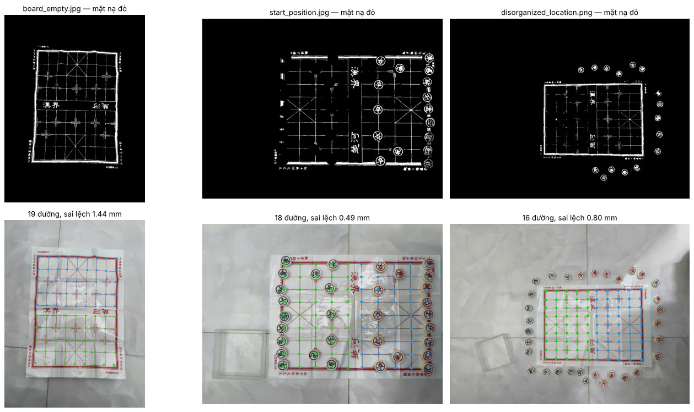

Ảnh mẫu trong `samples/`: `board_empty.jpg`, `start_position.jpg`, `disorganized_location.png`. Chi tiết: `image_preprocessing.ipynb`.

---

## 6. Mang sang robot

- Toàn bộ trong **một file** `xiangqi_to_robot.zip` (Bước 6): mã nguồn, `best.onnx`, Pikafish cho ARM, `install.sh`.
- Trên robot: `cd ~/xiangqi && sh install.sh`, tự build `best.engine` (TensorRT FP16) trên chính Jetson:
  `/usr/src/tensorrt/bin/trtexec --onnx=best.onnx --saveEngine=best.engine --fp16`
- Phía robot dùng TensorRT trực tiếp; nơi khác dùng onnxruntime. Tiền xử lý và NMS tự cài đặt trong `vision/pieces.py`.
- Hướng dẫn gọi thư viện: `API.md`; chạy demo trên Windows: `DEMO_WINDOWS.md`.

---

## 7. Hạn chế và việc còn lại

1. **Chưa có ảnh từ camera robot** trong dữ liệu huấn luyện và đánh giá; mọi con số ở trên đo trên ảnh công khai.
2. **Chưa đo tốc độ TensorRT FP16 và Pikafish trên Jetson Nano** (đọc từ `trtexec` và `tools/bench_engine.py`).
3. Log huấn luyện giai đoạn 2 ghi 5 469 ảnh train, trong khi `merged_v1.zip` hiện tại chia 5 356 / 739 / 713. Nếu dataset được chia lại sau khi train, nên **train lại trên cách chia hiện tại** để số test hoàn toàn khách quan.
4. Robot không với tới toàn bộ bàn cờ; phần tích hợp tay máy (hiệu chuẩn camera–robot, gắp–đặt) đang làm.

---

## 8. Hình trong báo cáo lấy từ đâu

| Chương báo cáo | Notebook |
|---|---|
| Chương 3 (robot, phần cứng, tầm với) | `jetmax_deploy.ipynb` |
| Chương 4: hình 4.2–4.10 (dữ liệu) | `build_dataset.ipynb` |
| Chương 4: hình 4.12–4.14 (kích thước quân, tăng cường) | `train_yolo11.ipynb` |
| Chương 4: hình 4.1, 4.11, 4.15–4.22 (xử lý ảnh) | `image_preprocessing.ipynb` |
| Chương 5 (huấn luyện, đánh giá, ONNX) | `train_yolo11.ipynb`, `jetmax_deploy.ipynb` |
| Chương 6 (ảnh → FEN, luật cờ, Pikafish) | `board_to_fen.ipynb`, `rules_engine.ipynb` |
| Chương 7 (thư viện, đóng gói) | `package.ipynb` |

Các hình trong `images/` của README được trích từ output của chính các notebook trên.
